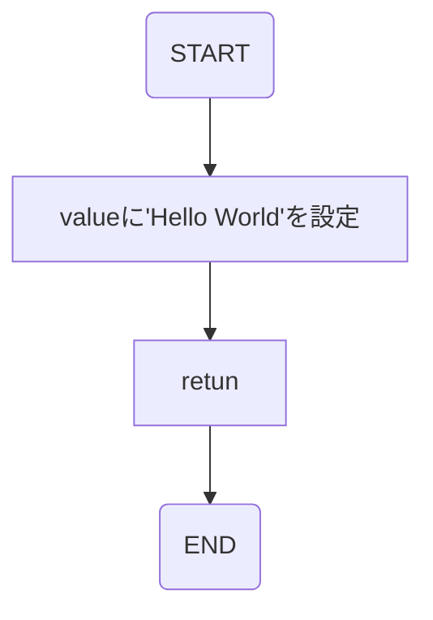

# Hello World API詳細

## APIの概要
<table style="width:100%">
  <tr>
    <th>API名</th>
    <td>Hello World API</td>
  </tr>
  <tr>
    <th>概要</th>
    <td>"Hello World!"を返す</td>
  </tr>
  <tr>
    <th>Method</th>
    <td>Get</td>
  </tr>
</table>

### アクセスURI
- api/demo/helloworld

### インプットパラメータ
- なし

### HTTPレスポンスコード
| コード値 | 名称 | 説明 |
| -- | -- | -- |
| 200 | OK | リクエスト成功 |
| 200以外 | NG | 何かしらのエラーで失敗 |

### アウトプットパラメータ
| json key | 型 | 説明 |
| -- | -- | -- |
| value | 文字列 | 挨拶が入る |

## フローチャート
