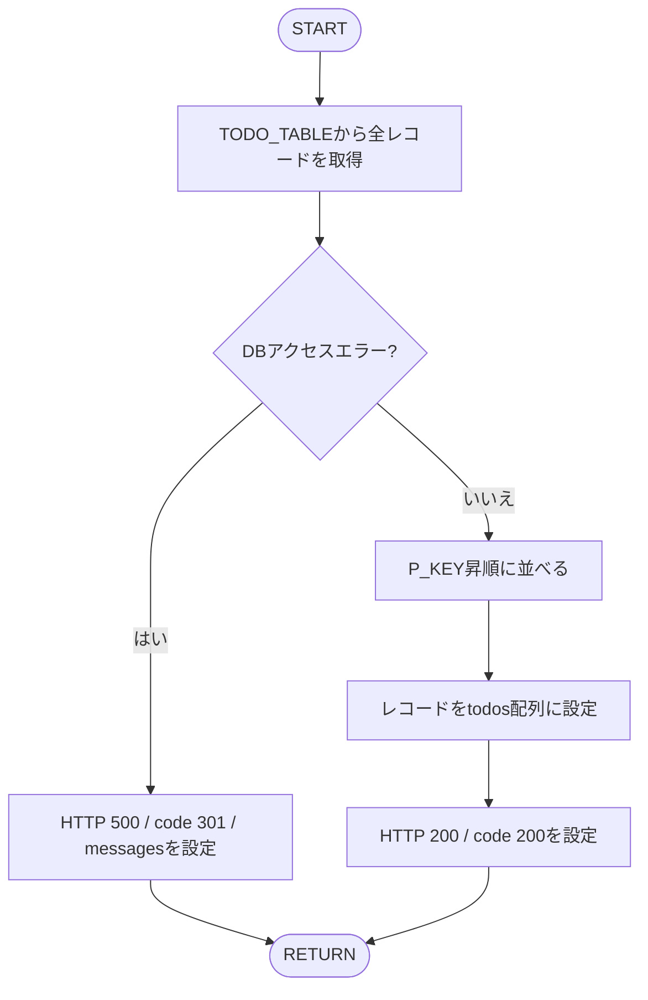

# Todo Get API詳細設計書
## APIの概要
<table style="width:100%">
  <tr>
    <th>API名</th>
    <td>Todo Get API</td>
  </tr>
  <tr>
    <th>概要</th>
    <td>TODOを取得する</td>
  </tr>
  <tr>
    <th>Method</th>
    <td>GET</td>
  </tr>
</table>

### アクセスURI
- `/api/todo/getAll`

### インプットパラメータ
- なし

### 取得条件
- TODO_TABLEの全レコードを取得する。
- `P_KEY`の昇順で返却する。
- レコードが存在しない場合も正常終了し、`todos`に空配列を返却する。

### レスポンスコード
| 業務コード (`code`) | HTTPステータス | 名称 | 説明 |
| -- | -- | -- | -- |
| 200 | 200 OK | OK | リクエスト成功 |
| 301 | 500 Internal Server Error | NG | DBアクセスエラー |

### アウトプットパラメータ
| JSONキー | 型 | 説明 |
| -- | -- | -- |
| `code` | Number | 業務コード（200/301）。常に返却する。 |
| `todos` | Array\<Object\> | 取得したTODOの配列。成功時に返却する。0件の場合は空配列。 |
| `todos[].p_key` | Number | TODOの主キー。 |
| `todos[].done_flag` | boolean | タスク完了フラグ。 |
| `todos[].task` | String | TODOの内容。 |
| `todos[].registed_date` | String | タスク開始日（`YYYY/MM/DD`）。値がnullの場合は省略する。 |
| `todos[].limit_date` | String | タスク終了日（`YYYY/MM/DD`）。値がnullの場合は省略する。 |
| `todos[].memo` | String | 備考。値がnullの場合は省略する。 |
| `messages` | Array\<String\> | エラー内容。エラー時のみ返却する。 |

### レスポンス例
TODOが取得できた場合:

```json
{
  "code": 200,
  "todos": [
    {
      "p_key": 1,
      "done_flag": false,
      "task": "買い物へ行く",
      "registed_date": "2026/01/05",
      "limit_date": "2026/01/31",
      "memo": "牛乳を買う"
    },
    {
      "p_key": 2,
      "done_flag": true,
      "task": "書類を提出する"
    }
  ]
}
```

TODOが0件の場合:

```json
{
  "code": 200,
  "todos": []
}
```

DBアクセスエラーの場合:

```json
{
  "code": 301,
  "messages": [
    "TODOの取得に失敗しました。"
  ]
}
```

※値がnullの項目はレスポンスに含めない。

## DBアクセス
- 対象テーブル：TODO_TABLE

| 取得カラム | データ型 | レスポンス項目 | 備考 |
| -- | -- | -- | -- |
| `P_KEY` | INTEGER | `todos[].p_key` | 主キー。 |
| `TASK` | VARCHAR(100) | `todos[].task` | TODOの内容。 |
| `REGISTED_DATE` | DATE | `todos[].registed_date` | `YYYY/MM/DD`形式に変換する。 |
| `LIMIT_DATE` | DATE | `todos[].limit_date` | `YYYY/MM/DD`形式に変換する。 |
| `MEMO` | VARCHAR(500) | `todos[].memo` | 備考。 |
| `DONE_FLAG` | BOOLEAN | `todos[].done_flag` | タスク完了フラグ。 |

## フローチャート


