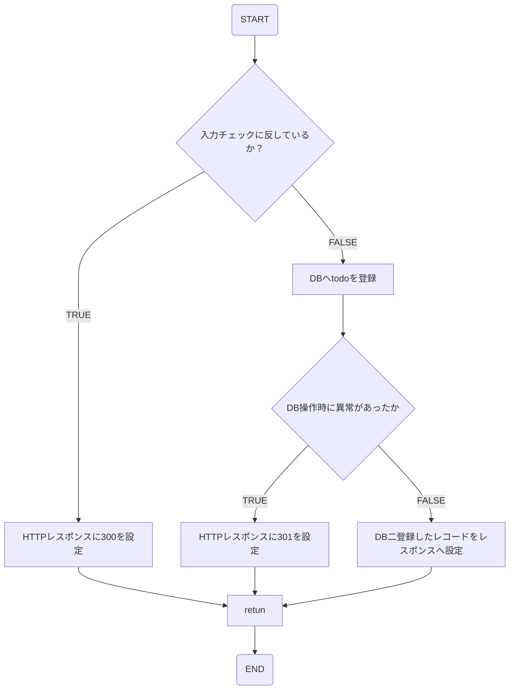

# Todo Regist API詳細設計書
## APIの概要
<table style="width:100%">
  <tr>
    <th>API名</th>
    <td>Todo Regist API</td>
  </tr>
  <tr>
    <th>概要</th>
    <td>TODOを登録する</td>
  </tr>
  <tr>
    <th>Method</th>
    <td>Post</td>
  </tr>
</table>

### アクセスURI
- api/todo/regist

### インプットパラメータ
| json key | 型 | 説明 |
| -- | -- | -- |
| task | String | todoを格納 |
| registed_date | String | タスク開始日 |
| limit_date | String | タスク終了日 |
| memo | String | 備考 |

### HTTPレスポンスコード
| コード値 | 名称 | 説明 |
| -- | -- | -- |
| 200 | OK | リクエスト成功 |
| 300 | NG | 入力チェックエラー |
| 301 | NG | DB関連エラー |
| 200以外 | NG | 何かしらのエラーで失敗 |

### アウトプットパラメータ
| json key | 型 | 説明 |
| -- | -- | -- |
| task | String | todoを格納 |
| registed_date | String | タスク開始日 |
| limit_date | String | タスク終了日 |
| memo | String | 備考 |

## 入力チェック
<table>
	<tbody>
    <tr>
			<th>カテゴリ</th>
			<th>チェック内容</th>
      <th>対象項目</th>
      <th>備考</th>
		</tr>
		<tr>
			<td rowspan="4">型チェック</td>
			<td rowspan="4">文字列であること</td>
			<td>task</td>
      <td>-<td>
		</tr>
		<tr>
			<td>registed_date</td>
      <td>-</td>
		</tr>
		<tr>
			<td>limit_date</td>
			<td>-</td>
		</tr>
		<tr>
			<td>memo</td>
			<td>-</td>
		</tr>
    <tr>
      <td rowspan="2">フォーマットチェック</td>
      <td  rowspan="2">YYYY/MM/DDとなっていること</td>
      <td>registed_date</td>
      <td>-</td>
    </tr>
    <tr>
			<td>limit_date</td>
			<td>-</td>
		</tr>
    <tr>
			<td rowspan="2">桁数チェック</td>
			<td>100文字以内であること</td>
			<td>task</td>
      <td>-<td>
		</tr>
    <tr>
      <td>500文字以内であること</td>
			<td>memo</td>
			<td>-</td>
		</tr>
	</tbody>
</table>

## フローチャート
