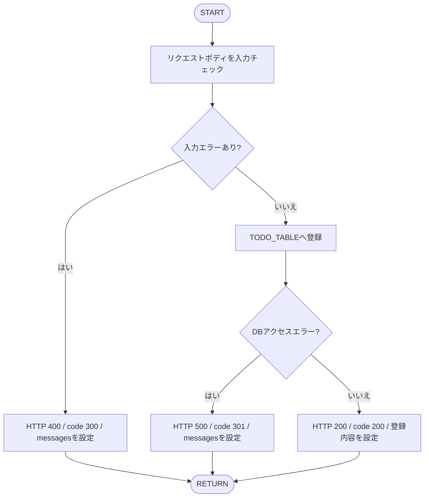

# Todo Regist API詳細設計書
## APIの概要
<table style="width:100%">
  <tr>
    <th>API名</th>
    <td>Todo Regist API</td>
  </tr>
  <tr>
    <th>概要</th>
    <td>TODOを登録する</td>
  </tr>
  <tr>
    <th>Method</th>
    <td>POST</td>
  </tr>
</table>

### アクセスURI
- `/api/todo/regist`

### リクエスト
- Content-Type: `application/json`
- リクエストボディはJSONオブジェクトとする。

```json
{
  "task": "買い物へ行く",
  "registed_date": "2026/01/05",
  "limit_date": "2026/01/31",
  "memo": "牛乳を買う"
}
```

### インプットパラメータ
| JSONキー | 型 | 必須 | 制約・説明 |
| -- | -- | -- | -- |
| `task` | String | ○ | TODOの内容。空文字不可、100文字以内。 |
| `registed_date` | String | - | タスク開始日。`YYYY/MM/DD`形式。省略、null、空文字を許容する。 |
| `limit_date` | String | - | タスク終了日。`YYYY/MM/DD`形式。省略、null、空文字を許容する。 |
| `memo` | String | - | 備考。500文字以内。省略、null、空文字を許容する。 |

※任意項目を指定する場合、日付項目は文字列で有効な日付を指定すること。各項目にnull以外の値を指定する場合は、文字列で指定すること。

### レスポンスコード
入力エラーおよびDBエラーは、HTTPステータスとレスポンスボディの業務コードを分けて返却する。

| 業務コード (`code`) | HTTPステータス | 名称 | 説明 |
| -- | -- | -- | -- |
| 200 | 200 OK | OK | リクエスト成功 |
| 300 | 400 Bad Request | NG | JSON形式不正、または入力チェックエラー |
| 301 | 500 Internal Server Error | NG | DBアクセスエラー |

※上記以外の予期しないエラーでは、共通のエラーハンドリングにより別のHTTPステータスが返る場合がある。

### アウトプットパラメータ
| json key | 型 | 説明 |
| -- | -- | -- |
| `code` | Number | 業務コード（200/300/301）。常に返却する。 |
| `task` | String | 登録したTODOの内容。成功時のみ返却する。 |
| `registed_date` | String | タスク開始日（`YYYY/MM/DD`）。成功時かつ値がある場合に返却する。 |
| `limit_date` | String | タスク終了日（`YYYY/MM/DD`）。成功時かつ値がある場合に返却する。 |
| `memo` | String | 備考。成功時かつ値がある場合に返却する。 |
| `messages` | Array\<String\> | エラー内容。エラー時のみ返却する。 |

### レスポンス例
成功時:

```json
{
  "code": 200,
  "task": "買い物へ行く",
  "registed_date": "2026/01/05",
  "limit_date": "2026/01/31",
  "memo": "牛乳を買う"
}
```

入力チェックエラー時:

```json
{
  "code": 300,
  "messages": [
    "taskは必須です。"
  ]
}
```

※値がnullの項目はレスポンスに含めない。

## 入力チェック
| カテゴリ | チェック内容 | 対象項目 | エラー時のメッセージ |
| -- | -- | -- | -- |
| 必須 | 項目が存在し、nullまたは空文字でないこと | `task` | `taskは必須です。` |
| 型 | 文字列であること | `task`、`registed_date`、`limit_date`、`memo` | `{項目名}は文字列で指定してください。` |
| 日付形式 | 実在する日付を`YYYY/MM/DD`形式で指定すること | `registed_date`、`limit_date` | `{項目名}はYYYY/MM/DD形式で指定してください。` |
| 桁数 | 100文字以内であること | `task` | `taskは100文字以内で指定してください。` |
| 桁数 | 500文字以内であること | `memo` | `memoは500文字以内で指定してください。` |

※`task`の空白のみの文字列は空文字ではないため、必須チェックではエラーにならない。
※日付項目の省略、null、空文字は入力エラーとせず、未設定として扱う。
※複数の入力エラーがある場合、`messages`に該当するメッセージを複数返却する。

## DBアクセス
- 対象テーブル：TODO_TABLE

| カラム | データ型 | 登録内容 |
| -- | -- | -- |
| `P_KEY` | INTEGER | DBで採番する。 |
| `TASK` | VARCHAR(100) | リクエストの`task`。 |
| `REGISTED_DATE` | DATE | リクエストの`registed_date`。未指定時はnull。 |
| `LIMIT_DATE` | DATE | リクエストの`limit_date`。未指定時はnull。 |
| `MEMO` | VARCHAR(500) | リクエストの`memo`。未指定時はnull。 |
| `DONE_FLAG` | BOOLEAN | `false`（新規登録時の固定値）。 |
| `CREATE_DATE` | DATE | 登録処理実行日のシステム日付。 |
| `UPDATE_DATE` | DATE | 登録処理実行日のシステム日付。 |

## フローチャート
